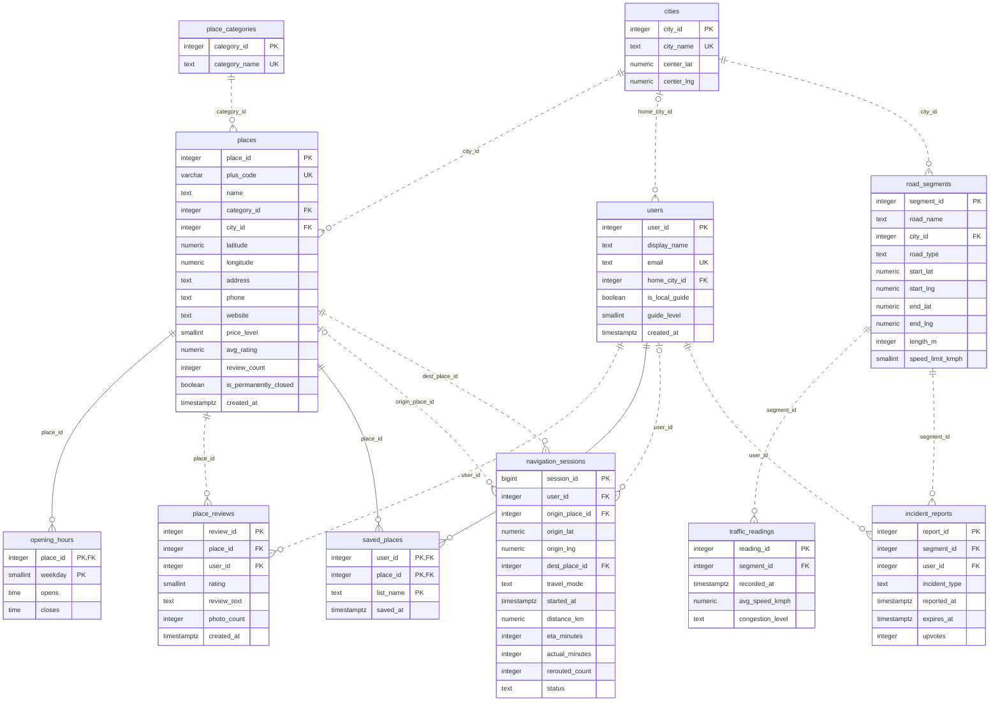

# Google Maps Navigation Database — schema design

## Scope and design choices

The `gmaps` schema keeps the 11 CSV table names and every header in the supplied order. City and category details are stored once and referenced by ID. Reviews and saves link users to places; road segments own traffic readings and incident reports; navigation sessions link a required destination to an optional user and origin listing. Session GPS coordinates are required whether or not an origin listing exists.

The load script uses `psql`'s client-side `\copy`. From the project root, extract `seed_data.zip`, create an empty PostgreSQL 15+ database, and run:

```sh
createdb gmaps_cp1
psql -X -d gmaps_cp1 -f sql/01_schema.sql
psql -X -d gmaps_cp1 -f sql/02_load_data.sql
```

Each script stops on error and runs in a transaction. The loader checks CSV header order, loads parents before children, and runs `ANALYZE` after the data are in place. For workload queries that group by local date or hour, use the same `Asia/Kolkata` session time zone on every run. `timestamptz` stores the instant; opening hours are local wall-clock times.

Hours use ISO weekdays (Monday = 1). A missing hours row means no schedule was supplied for that day. `00:00–24:00` represents all day; a closing time earlier than the opening time extends into the next day. A general “open now” search must also look at yesterday's overnight window after midnight. The supplied workload remains as given.

Phone, website and price level can be absent; the export supplies prices only for restaurant listings. Phone values happen to be unique among populated seed rows, but businesses can share a contact number, so it is not a candidate key. Plus Code is unique within this dataset; the format check does not assert that it geocodes to the stored coordinates. A non-guide has no guide level. A navigation user can be anonymous, an origin can come from GPS alone, and only completed trips have an actual duration. Missing information stays NULL.

`CASCADE` applies to dependent facts such as a listing's hours and a segment's readings. `RESTRICT` protects required references where history or attribution would be lost, such as a session's destination and an incident's reporter. `SET NULL` preserves rows with an optional reference, such as a session's user or origin place, after the parent is removed. Permanent closures normally retain the listing and its history.

## Entity relationship diagram

Each connector is one parent to zero or many children; a circle at the parent end means the reference is optional for that child. Reviews and saves each resolve a many-to-many relationship between users and places. The two links from places to navigation sessions represent different roles. There is no required one-to-one relationship. The dictionary below gives the exact composite key definitions.



## Functional dependencies and normal forms

For each relation, every listed candidate key determines all other attributes. “BCNF” below assumes the stated business rules, rather than treating patterns that happen to hold in the export as permanent dependencies.

| Relation | Candidate keys and determinants | Normal form and reasoning |
|---|---|---|
| `cities` | `city_id` or `city_name` → centre coordinates and the other identifier | BCNF within the dataset's unique city naming scope. |
| `place_categories` | `category_id` or `category_name` → the other | BCNF; both determinants are keys. |
| `places` | `place_id` or `plus_code` → remaining attributes | BCNF for the listing facts; the rating and review count are deliberate caches derived from another relation. |
| `opening_hours` | `(place_id, weekday)` → `opens, closes` | BCNF; a place alone may have different hours across the week and a weekday alone cannot identify a place's hours. |
| `users` | `user_id` or `email` → remaining attributes | Account facts depend on a key. The stored guide flag is redundant under the rule that guide level is present exactly for guides. If treating the nullable level as a determinant of the flag, this is an intentional 3NF/BCNF exception kept for the supplied workload. |
| `place_reviews` | `review_id` or `(place_id, user_id)` → remaining attributes | BCNF; one review per user and place. The unique pair also supports W02's conflict target. |
| `saved_places` | `(user_id, place_id, list_name)` → `saved_at` | BCNF; the timestamp belongs to the particular save. The seed actually has a user/place pair in two lists, so that pair alone is not a key. |
| `road_segments` | `segment_id` → remaining attributes | BCNF; road name and type can repeat. The export uses one speed limit per road type, but real posted limits can vary within a type, so `road_type → speed_limit_kmph` is not enforced. |
| `traffic_readings` | `reading_id` or `(segment_id, recorded_at)` → remaining attributes | Key-based reading facts. If congestion is defined by fixed thresholds on speed and the segment limit, the stored band is redundant (a non-key determinant could violate 3NF/BCNF). We keep the observed band for the workload because the classification rule is not specified. |
| `navigation_sessions` | `session_id` → remaining attributes | BCNF for independent trip observations. ETA is an estimate captured at departure; distance and mode alone do not specify traffic, route, or routing-model inputs. Start coordinates are a session snapshot, so no dependency on a place's *current* coordinates is enforced. |
| `incident_reports` | `report_id` → remaining attributes | BCNF; neither reporter, road segment, incident type, nor timestamp is declared a separate identifier. |

The schema uses one value per column and one fact per row (1NF). No composite key has a non-key fact that depends on only part of that key (2NF). Moving category names, city details, user profiles and segment details into their own tables removes transitive lookup dependencies from child tables. The workload needs the remaining stored observations and caches listed above. W04 refreshes listing caches for listings with reviews; stale caches are measured before refresh instead of being rejected or silently rewritten at import.

Only the primary-key and unique constraints create indexes at CP1. The alternate keys create additional unique indexes on city name, category name, Plus Code, email, review place/user, and traffic segment/time. No independent tuning index is installed.

## Data dictionary

### `cities`

| Column | PostgreSQL type | Constraint | Why |
|---|---|---|---|
| `city_id` | `integer` | `PRIMARY KEY` | Stable city identifier. |
| `city_name` | `text` | `NOT NULL UNIQUE` | Unique city label within this India dataset. |
| `center_lat` | `numeric(8,6)` | `NOT NULL CHECK (center_lat BETWEEN -90 AND 90)` | City centre latitude in degrees. |
| `center_lng` | `numeric(9,6)` | `NOT NULL CHECK (center_lng BETWEEN -180 AND 180)` | City centre longitude in degrees. |

### `place_categories`

| Column | PostgreSQL type | Constraint | Why |
|---|---|---|---|
| `category_id` | `integer` | `PRIMARY KEY` | Stable category identifier. |
| `category_name` | `text` | `NOT NULL UNIQUE` | Unique label used in category lookups. |

### `places`

| Column | PostgreSQL type | Constraint | Why |
|---|---|---|---|
| `place_id` | `integer` | `PRIMARY KEY` | Stable listing identifier. |
| `plus_code` | `varchar(11)` | `NOT NULL UNIQUE CHECK (plus_code ~ '^[23456789CFGHJMPQRVWX]{8}[+][23456789CFGHJMPQRVWX]{2}$')` | Unique full-length locator in the export. |
| `name` | `text` | `NOT NULL` | Listing name; different listings can share one. |
| `category_id` | `integer` | `NOT NULL REFERENCES place_categories ON DELETE RESTRICT` | Required category; prevent removing an in-use category. |
| `city_id` | `integer` | `NOT NULL REFERENCES cities ON DELETE RESTRICT` | Required city; preserve location context. |
| `latitude` | `numeric(8,6)` | `NOT NULL CHECK (latitude BETWEEN -90 AND 90)` | Listing latitude. |
| `longitude` | `numeric(9,6)` | `NOT NULL CHECK (longitude BETWEEN -180 AND 180)` | Listing longitude. |
| `address` | `text` | `NOT NULL` | Display address; may be shared. |
| `phone` | `text` | `NULL` | Optional contact number; text preserves the plus prefix. |
| `website` | `text` | `NULL` | Optional URL. |
| `price_level` | `smallint` | `NULL CHECK (price_level BETWEEN 1 AND 4)` | Optional price band; absent in categories without one in this export. |
| `avg_rating` | `numeric(2,1)` | `NULL CHECK (avg_rating BETWEEN 1 AND 5)` | Stored one-decimal rating; NULL can represent an unrated listing. |
| `review_count` | `integer` | `NOT NULL CHECK (review_count >= 0)` | Stored count; compared to the review rows. |
| `is_permanently_closed` | `boolean` | `NOT NULL` | Closure flag; preserves the listing for historical trips. |
| `created_at` | `timestamptz` | `NOT NULL` | Listing creation instant. |

### `opening_hours`

| Column | PostgreSQL type | Constraint | Why |
|---|---|---|---|
| `place_id` | `integer` | `NOT NULL REFERENCES places ON DELETE CASCADE` | Owning listing; hours have no independent lifecycle. |
| `weekday` | `smallint` | `NOT NULL CHECK (weekday BETWEEN 1 AND 7)` | ISO weekday, Monday = 1. |
| `opens` | `time` | `NOT NULL CHECK (opens < TIME '24:00')` | Local opening time. |
| `closes` | `time` | `NOT NULL CHECK (closes <> opens)` | Local closing time; earlier than opens means next day. |

Table constraints: `PRIMARY KEY (place_id, weekday)`.

### `users`

| Column | PostgreSQL type | Constraint | Why |
|---|---|---|---|
| `user_id` | `integer` | `PRIMARY KEY` | Stable account identifier. |
| `display_name` | `text` | `NOT NULL` | Public display label; can repeat. |
| `email` | `text` | `NOT NULL UNIQUE` | Unique account address in the export. |
| `home_city_id` | `integer` | `NULL REFERENCES cities ON DELETE SET NULL` | Optional home city; keep the account if the city is removed. |
| `is_local_guide` | `boolean` | `NOT NULL` | Local Guide membership flag. |
| `guide_level` | `smallint` | `NULL CHECK (guide_level BETWEEN 1 AND 10)` | Only Local Guides have a level. |
| `created_at` | `timestamptz` | `NOT NULL` | Account creation instant. |

Table constraints: `CHECK (is_local_guide = (guide_level IS NOT NULL))`.

### `place_reviews`

| Column | PostgreSQL type | Constraint | Why |
|---|---|---|---|
| `review_id` | `integer` | `PRIMARY KEY` | Stable review identifier. |
| `place_id` | `integer` | `NOT NULL REFERENCES places ON DELETE CASCADE` | Reviewed listing; remove reviews when their listing is deleted. |
| `user_id` | `integer` | `NOT NULL REFERENCES users ON DELETE CASCADE` | Author; remove authored reviews with the account. |
| `rating` | `smallint` | `NOT NULL CHECK (rating BETWEEN 1 AND 5)` | Whole-star score. |
| `review_text` | `text` | `NULL` | A star rating can omit written feedback. |
| `photo_count` | `integer` | `NOT NULL CHECK (photo_count >= 0)` | Number of attached photos. |
| `created_at` | `timestamptz` | `NOT NULL` | Review creation instant. |

Table constraints: `UNIQUE (place_id, user_id)`.

### `saved_places`

| Column | PostgreSQL type | Constraint | Why |
|---|---|---|---|
| `user_id` | `integer` | `NOT NULL REFERENCES users ON DELETE CASCADE` | List owner; delete saves with the account. |
| `place_id` | `integer` | `NOT NULL REFERENCES places ON DELETE CASCADE` | Saved listing; remove links to deleted places. |
| `list_name` | `text` | `NOT NULL CHECK (list_name IN ('Want to go', 'Starred', 'Favourites', 'Travel plans'))` | Built-in list label; the same place can appear in several lists. |
| `saved_at` | `timestamptz` | `NOT NULL` | When the place was saved to this list. |

Table constraints: `PRIMARY KEY (user_id, place_id, list_name)`.

### `road_segments`

| Column | PostgreSQL type | Constraint | Why |
|---|---|---|---|
| `segment_id` | `integer` | `PRIMARY KEY` | Stable segment identifier. |
| `road_name` | `text` | `NOT NULL` | Road label can repeat across segments. |
| `city_id` | `integer` | `NOT NULL REFERENCES cities ON DELETE RESTRICT` | Required city; preserve segment geography. |
| `road_type` | `text` | `NOT NULL CHECK (road_type IN ('ARTERIAL', 'LOCAL', 'HIGHWAY'))` | Road classification. |
| `start_lat` | `numeric(8,6)` | `NOT NULL CHECK (start_lat BETWEEN -90 AND 90)` | Start latitude. |
| `start_lng` | `numeric(9,6)` | `NOT NULL CHECK (start_lng BETWEEN -180 AND 180)` | Start longitude. |
| `end_lat` | `numeric(8,6)` | `NOT NULL CHECK (end_lat BETWEEN -90 AND 90)` | End latitude. |
| `end_lng` | `numeric(9,6)` | `NOT NULL CHECK (end_lng BETWEEN -180 AND 180)` | End longitude. |
| `length_m` | `integer` | `NOT NULL CHECK (length_m > 0)` | Length in metres. |
| `speed_limit_kmph` | `smallint` | `NOT NULL CHECK (speed_limit_kmph > 0)` | Posted speed limit; can vary by segment. |

### `traffic_readings`

| Column | PostgreSQL type | Constraint | Why |
|---|---|---|---|
| `reading_id` | `integer` | `PRIMARY KEY` | Stable reading identifier. |
| `segment_id` | `integer` | `NOT NULL REFERENCES road_segments ON DELETE CASCADE` | Measured segment; remove its readings if it is deleted. |
| `recorded_at` | `timestamptz` | `NOT NULL` | Measurement instant; unique per segment. |
| `avg_speed_kmph` | `numeric(5,1)` | `NOT NULL CHECK (avg_speed_kmph >= 0)` | Measured speed; can exceed the posted limit. |
| `congestion_level` | `text` | `NOT NULL CHECK (congestion_level IN ('LOW', 'MODERATE', 'HEAVY', 'STANDSTILL'))` | Reported traffic band; standstill is allowed by the workload. |

Table constraints: `UNIQUE (segment_id, recorded_at)`.

### `navigation_sessions`

| Column | PostgreSQL type | Constraint | Why |
|---|---|---|---|
| `session_id` | `bigint` | `PRIMARY KEY` | Stable session identifier with headroom for growth. |
| `user_id` | `integer` | `NULL REFERENCES users ON DELETE SET NULL` | Anonymous trips and trips retained after account deletion. |
| `origin_place_id` | `integer` | `NULL REFERENCES places ON DELETE SET NULL` | Optional origin listing; keep recorded GPS when a listing is removed. |
| `origin_lat` | `numeric(8,6)` | `NOT NULL CHECK (origin_lat BETWEEN -90 AND 90)` | Captured start latitude, even for listed origins. |
| `origin_lng` | `numeric(9,6)` | `NOT NULL CHECK (origin_lng BETWEEN -180 AND 180)` | Captured start longitude. |
| `dest_place_id` | `integer` | `NOT NULL REFERENCES places ON DELETE RESTRICT` | Required destination; preserve trip history. |
| `travel_mode` | `text` | `NOT NULL CHECK (travel_mode IN ('DRIVE', 'TRANSIT', 'WALK', 'TWO_WHEELER'))` | Mode selected for the trip. |
| `started_at` | `timestamptz` | `NOT NULL` | Trip start instant. |
| `distance_km` | `numeric(8,2)` | `NOT NULL CHECK (distance_km >= 0)` | Route length estimate in kilometres. |
| `eta_minutes` | `integer` | `NOT NULL CHECK (eta_minutes > 0)` | Predicted duration captured at trip start. |
| `actual_minutes` | `integer` | `NULL CHECK (actual_minutes > 0)` | Measured duration for completed trips. |
| `rerouted_count` | `integer` | `NOT NULL DEFAULT 0 CHECK (rerouted_count >= 0)` | Starts at zero, including W01 which omits the column. |
| `status` | `text` | `NOT NULL CHECK (status IN ('COMPLETED', 'CANCELLED', 'IN_PROGRESS'))` | Current or terminal trip status. |

Table constraints: `CHECK ((status = 'COMPLETED') = (actual_minutes IS NOT NULL))`.

### `incident_reports`

| Column | PostgreSQL type | Constraint | Why |
|---|---|---|---|
| `report_id` | `integer` | `PRIMARY KEY` | Stable report identifier. |
| `segment_id` | `integer` | `NOT NULL REFERENCES road_segments ON DELETE CASCADE` | Affected segment; remove reports attached to a deleted segment. |
| `user_id` | `integer` | `NOT NULL REFERENCES users ON DELETE RESTRICT` | Required reporter for moderation and attribution. |
| `incident_type` | `text` | `NOT NULL CHECK (incident_type IN ('ROADWORK', 'POLICE', 'CLOSURE', 'WATERLOGGING', 'ACCIDENT', 'BREAKDOWN'))` | Report classification. |
| `reported_at` | `timestamptz` | `NOT NULL` | Submission instant. |
| `expires_at` | `timestamptz` | `NOT NULL CHECK (expires_at > reported_at)` | Expiry instant later than submission. |
| `upvotes` | `integer` | `NOT NULL CHECK (upvotes >= 0)` | Number of endorsements. |

## Seed verification

The counts below were measured by reading the supplied CSVs, excluding their headers.

| Table | Seed rows |
|---|---:|
| cities | 10 |
| place_categories | 12 |
| places | 40,042 |
| opening_hours | 252,266 |
| users | 40,000 |
| place_reviews | 89,998 |
| saved_places | 50,000 |
| road_segments | 2,000 |
| traffic_readings | 250,000 |
| navigation_sessions | 200,000 |
| incident_reports | 12,000 |
| **Total** | **936,328** |

The schema and all CSV imports were tested with PostgreSQL 17.5 via PGlite in a scratch database. The test applied the loader’s table order, explicit column lists and CSV options using PostgreSQL `COPY`. The `psql` client wrapper itself was not exercised. All 11 counts matched and the integrity checks below were reproduced in SQL. All 25 read and five write statements in the supplied workload executed unchanged. The workload transaction rolled back, and the W01 test session was absent afterwards.

| Integrity check on the supplied data | Observed result |
|---|---:|
| Sessions with a known origin place in a different city than the destination | 0 of 7,416 |
| Sessions with a known origin place whose GPS coordinates differ from the listing | 0 of 7,416 |
| Reviewed places with stale rating or review count | 558 of 34,431 |
| Places without any hours rows | 4,004 |
| Trips to destinations marked permanently closed in this export | 6,026 |
| Candidate duplicate pairs by the supplied R24 name-and-coordinate rule | 42 |

The latter four checks describe the data as supplied. Cache mismatches and duplicate candidates are retained for the data-quality workload. Missing hours can mean a schedule has not been collected. The closure flag is a snapshot, so a trip to a currently closed listing does not establish that the listing was closed on the trip date. The zero counts on the origin checks are observations, not constraints: intercity trips or historical GPS coordinates that differ from a listing's current coordinates can still be valid.

R13's empty result comes from SQL's treatment of NULL in `NOT IN`: 192,584 trips have no origin place. A correlated `NOT EXISTS` answers the intended question while keeping those trips valid. Keep the original R13 for the baseline; it must not drive a non-null constraint on `origin_place_id`.

### Reproducing the integrity checks in SQL

```sql
SET search_path TO gmaps;

-- Compare both the origin city and GPS snapshot when the place is known.
SELECT count(*) AS known_origin_trips,
       count(*) FILTER (WHERE o.city_id <> d.city_id) AS cross_city_trips,
       count(*) FILTER (
           WHERE (o.latitude, o.longitude)
                 IS DISTINCT FROM (n.origin_lat, n.origin_lng)
       ) AS coordinate_mismatches
FROM navigation_sessions n
JOIN places o ON o.place_id = n.origin_place_id
JOIN places d ON d.place_id = n.dest_place_id;

-- Compare the cache against review rows, limiting to reviewed places.
WITH actual AS (
    SELECT place_id, count(*) AS reviews, round(avg(rating), 1) AS rating
    FROM place_reviews
    GROUP BY place_id
)
SELECT count(*) AS reviewed_places,
       count(*) FILTER (WHERE p.review_count IS DISTINCT FROM a.reviews
                           OR p.avg_rating IS DISTINCT FROM a.rating) AS stale_places
FROM places p JOIN actual a USING (place_id);

SELECT count(*) AS missing_hours
FROM places p
WHERE NOT EXISTS (SELECT 1 FROM opening_hours h WHERE h.place_id = p.place_id);

SELECT count(*) AS trips_to_flagged_closed_places
FROM navigation_sessions n
JOIN places p ON p.place_id = n.dest_place_id
WHERE p.is_permanently_closed;

SELECT count(*) AS candidate_duplicate_pairs
FROM places a JOIN places b
  ON b.name = a.name AND b.place_id > a.place_id
 AND abs(b.latitude - a.latitude) < 0.001
 AND abs(b.longitude - a.longitude) < 0.001
WHERE a.city_id = 1 AND a.category_id = 1;
```
